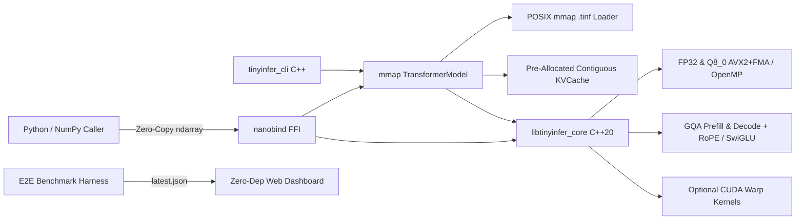

# tinyinfer-cpp

[](https://github.com/syahrulhidayat/tinyinfer-cpp/actions/workflows/ci.yml)

A lightweight, zero-dependency C++20 quantized AI inference runtime and tensor kernel engine
featuring block-32 `Q8_0` symmetric quantization, AVX2/FMA SIMD + OpenMP kernels,
pre-allocated contiguous KV-Cache with Grouped-Query Attention (GQA), zero-copy POSIX `mmap`
weight loading (`.tinf`), optional CUDA warp-reduced kernels, `nanobind` Python bindings,
and an interactive telemetry dashboard.

## Architecture



## Quickstart (One Command)

```bash
git clone https://github.com/syahrulhidayat/tinyinfer-cpp.git
cd tinyinfer-cpp
make cpp-test
make cpp-cli
python3 -m venv .venv && source .venv/bin/activate
make py-install
make verify
make dashboard
```

Open `http://127.0.0.1:8080` after `make dashboard` to inspect live throughput, memory
footprint, prefill latency, and numerical drift charts directly from `benchmarks/results/latest.json`.

To enable optional CUDA kernels on NVIDIA GPUs (e.g., Google Colab / Kaggle):

```bash
python3 benchmarks/colab_cuda_runner.py
```

## Engineering Trade-offs

1. **Row-Major `Y = X @ W^T` Weight Layout:** Streams weights contiguously across L1/L2/L3
   cache lines during memory-bandwidth-bound autoregressive decoding without runtime transposes.
2. **Block-32 `Q8_0` Symmetric Quantization:** Compresses FP32 linear weights by ~3.56x
   (32 `int8_t` + 1 `float` scale per block), fitting larger layers inside L3 cache while
   preserving >0.9995 cosine similarity end-to-end.
3. **Zero-Copy POSIX `mmap` + Pre-Allocated Scratch Buffers:** Maps `.tinf` weights read-only
   directly from disk (`PROT_READ | MAP_PRIVATE`) and reuses layer scratch vectors +
   `thread_local` attention score buffers so decode loops perform zero heap allocations.
4. **Pre-Allocated Contiguous GQA KV-Cache (`[layer, pos, kv_head, head_dim]`):** Cuts KV
   memory footprint by `n_q_heads / n_kv_heads` (4x for 32Q/8KV) with single `memcpy` updates.
5. **Compile-Time CUDA Toggle + Stdlib Web Dashboard:** Keeps the default CPU/CI build
   dependency-free (`cmake` + `ctest`) while providing real warp-reduced CUDA kernels
   (`-DTINYINFER_ENABLE_CUDA=ON`) and a zero-dependency stdlib HTTP/Canvas telemetry viewer.

## Benchmarks & Numerical Parity

Reproduce all kernel and end-to-end Transformer numbers and refresh the tables below:

```bash
make cpp-bench
make bench-attn
make bench-update
```

### Kernel Microbenchmarks (GEMV & GEMM)

<!-- BENCHMARK_START -->
| Kernel Workload | Implementation | Mean Latency (ms) | Throughput (GFLOP/s) | Weight Memory (MB) | Cosine Sim vs FP32 | Max Abs Drift |
| :--- | :--- | :---: | :---: | :---: | :---: | :---: |
| Decode GEMV (`1x2048 @ 2048x2048`) | NumPy FP32 | 0.083 | 101.10 | 16.00 | 1.000000 | 0.00e+00 |
| Decode GEMV (`1x2048 @ 2048x2048`) | tinyinfer FP32 | 0.088 | 95.85 | 16.00 | 1.000000 | 6.48e-05 |
| Decode GEMV (`1x2048 @ 2048x2048`) | tinyinfer Q8_0 | 0.086 | 97.67 | 4.50 | 0.999985 | 8.99e-01 |
| Prefill GEMM (`32x1024 @ 1024x1024`) | NumPy FP32 | 0.243 | 275.68 | 4.00 | 1.000000 | 0.00e+00 |
| Prefill GEMM (`32x1024 @ 1024x1024`) | tinyinfer FP32 | 2.277 | 29.48 | 4.00 | 1.000000 | 3.81e-05 |
| Prefill GEMM (`32x1024 @ 1024x1024`) | tinyinfer Q8_0 | 0.856 | 78.38 | 1.12 | 0.999986 | 7.65e-01 |

*Hardware baseline: AMD Ryzen 5 6600H with Radeon Graphics (12 threads), AVX2+FMA=ON, OpenMP=ON (12 threads), Linux 7.3.3-200.fc44.x86_64, measured on 2026-11-24 UTC.*
<!-- BENCHMARK_END -->

### End-to-End Decoder-Only Transformer (`mmap` Runtime vs Baseline)

<!-- E2E_BENCHMARK_START -->
| Backend | Weights (MB) | Prefill (ms) | Decode (ms) | Decode (tok/s) | Cosine Sim | Max Abs Drift |
| :--- | :---: | :---: | :---: | :---: | :---: | :---: |
| NumPy FP32 (CPU) | 73.03 | 50.36 | 155.72 | 205.49 | 1.000000 | 0.00e+00 |
| tinyinfer FP32 (mmap) | 73.03 | 38.77 | 182.46 | 175.38 | 1.000000 | 2.26e-06 |
| tinyinfer Q8_0 (mmap) | 23.43 | 32.53 | 63.35 | 505.17 | 0.999791 | 6.60e-02 |

*Model: 6L, dim=512, hidden=1536, heads=8/2, vocab=2048 (prompt=8, decode=32 tok). Hardware: AMD Ryzen 5 6600H with Radeon Graphics (12 threads), AVX2+FMA=ON, OpenMP=ON, peak RSS=196.82 MB, 2026-11-24T21:32:41Z.*
<!-- E2E_BENCHMARK_END -->
