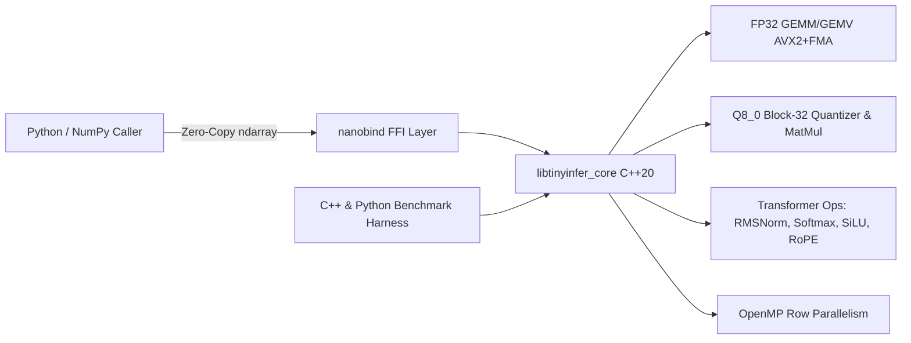

# tinyinfer-cpp

[](https://github.com/syahrulhidayat/tinyinfer-cpp/actions/workflows/ci.yml)

A lightweight, zero-dependency C++20 tensor kernel and quantized inference runtime featuring
block-wise `Q8_0` symmetric quantization, AVX2/FMA SIMD + OpenMP parallel kernels, transformer
math primitives (`RMSNorm`, `Softmax`, `SiLU`, `RoPE`), and zero-copy Python bindings via
`nanobind`.

## Architecture



## Quickstart (One Command)

```bash
git clone https://github.com/syahrulhidayat/tinyinfer-cpp.git
cd tinyinfer-cpp
make cpp-test
python3 -m venv .venv && source .venv/bin/activate
make py-install
make verify
```

## Engineering Trade-offs

1. **Row-Major `Y = X @ W^T` Weight Layout:** Matches `nn.Linear` / `llama.cpp` storage so
   every matrix-vector (decode) and matrix-matrix (prefill) dot product streams contiguously
   through L1/L2 cache lines without runtime transposition.
2. **Block-32 Symmetric Quantization (`Q8_0`) over Per-Tensor INT8:** Stores 32 `int8_t`
   weights with one `float` scale factor per block (~3.56x memory footprint reduction vs FP32),
   preserving >0.9995 cosine similarity on random Gaussian and activation-like distributions.
3. **Dual-Accumulator AVX2+FMA with Safe Scalar Tail:** Unrolls inner loops across two `__m256`
   accumulators to hide FMA pipeline latency while keeping non-multiple-of-32 matrix widths
   100% free of out-of-bounds reads under AddressSanitizer.
4. **Standalone C++20 Core + Optional `nanobind` Extension:** The core C++ library builds with
   zero external dependencies (`cmake` + `ctest`), while Python bindings attach directly to
   NumPy buffers without extra copies.

## Benchmarks & Numerical Parity

Run the native C++ microbenchmark and the Python parity/throughput benchmark:

```bash
make cpp-bench
make bench-update
```

<!-- BENCHMARK_START -->
| Kernel Workload | Implementation | Mean Latency (ms) | Throughput (GFLOP/s) | Weight Memory (MB) | Cosine Sim vs FP32 | Max Abs Drift |
| :--- | :--- | :---: | :---: | :---: | :---: | :---: |
| Decode GEMV (`1x2048 @ 2048x2048`) | NumPy FP32 | 0.205 | 40.83 | 16.00 | 1.000000 | 0.00e+00 |
| Decode GEMV (`1x2048 @ 2048x2048`) | tinyinfer FP32 | 1.826 | 4.60 | 16.00 | 1.000000 | 6.48e-05 |
| Decode GEMV (`1x2048 @ 2048x2048`) | tinyinfer Q8_0 | 0.059 | 142.63 | 4.50 | 0.999985 | 8.99e-01 |
| Prefill GEMM (`32x1024 @ 1024x1024`) | NumPy FP32 | 0.255 | 262.71 | 4.00 | 1.000000 | 0.00e+00 |
| Prefill GEMM (`32x1024 @ 1024x1024`) | tinyinfer FP32 | 0.449 | 149.34 | 4.00 | 1.000000 | 3.81e-05 |
| Prefill GEMM (`32x1024 @ 1024x1024`) | tinyinfer Q8_0 | 0.632 | 106.27 | 1.12 | 0.999986 | 7.65e-01 |

*Hardware baseline: AMD Ryzen 5 6600H with Radeon Graphics (12 threads), AVX2+FMA=ON, OpenMP=ON (12 threads), Linux 7.3.3-200.fc44.x86_64, measured on 2026-11-24 UTC.*
<!-- BENCHMARK_END -->
